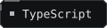
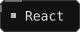
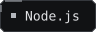
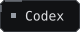
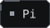

<picture>
  <source media="(prefers-reduced-motion: reduce)" srcset="assets/animations/pixel-noir-poster.png" />
  
</picture>

# Teo | Nexcore

**AI agents · AR interfaces · Independent research**

[Selected Projects](#selected-projects) · [Open Source](#open-source-contributions) · [English](#english) · [Русский](#русский)

  
  
  
  

## Selected Projects

| Project | What I work on | Role / stage |
| --- | --- | --- |
| [**TeoBench**](https://github.com/teo-nex/TeoBench) | Open model-reasoning benchmark with a 30-task Easy tier, [regraded community studies](https://github.com/teo-nex/TeoBench/tree/main/Easy-Bench/studies) and a separate [unverified report archive](https://github.com/teo-nex/TeoBench/tree/main/Easy-Bench/reports). | Maintainer · Open source |
| [**Jev**](https://github.com/teo-nex/jew-codex-harness) | Configurable model and reasoning routing for Codex, guarded coding workers and model-independent idle compaction. | Maintainer · Public alpha |
| [**CanvasTTY**](https://github.com/howdeploy/CanvasTTY) | Even G2 smart-glasses integration, CanvasLink Android LAN control and native Codex orchestration for an AI-agent desktop. | Contributor · Merged upstream |
| **Sky** | Experimental AI coding harness focused on token efficiency and development workflows. | Closed beta |

More projects · Even G2 apps & CanvasTTY tools

- [**NEXCORE Focus**](https://github.com/teo-nex/nexcore-focus) — tasks, focus timers and local Russian/English dictation for Even G2 and its phone companion. Source beta; installed-device dictation checks remain open. Based in part on [My Pomodoro](https://github.com/tarumzu/my-pomodoro-even-g2).
- [**NEXCORE Ticker**](https://github.com/teo-nex/NEXCORE-Markets) — shared crypto/US-stock watchlists and charts for phone and Even G2. Local beta, built on [Crypto Ticker](https://github.com/ARNLTony/even-g2-crypto-ticker) with original attribution preserved.
- [**Canvas Player**](https://github.com/teo-nex/canvastty-plugin-player) — a CanvasTTY integration of the existing music.deploychan.webcam player, opened as a canvas card beside terminals. Original player and media credits are preserved.
- [**CanvasTTY design kit**](https://github.com/teo-nex/CanvasTTY-design-for-agents) — an agent-readable guide and reference kit for creating installable pixel themes.

## Open-source contributions

### CanvasTTY

[**15 merged PRs**](https://github.com/pulls?q=is%3Apr+is%3Amerged+author%3Ateo-nex+repo%3Ahowdeploy%2FCanvasTTY) spanning agent control, smart glasses, Android and desktop reliability.

- **Even G2** — terminal output and AI-agent control through the glasses HUD, local voice dictation, session creation and local pairing. [Merged #50](https://github.com/howdeploy/CanvasTTY/pull/50).
- **CanvasLink** — the original Android/desktop integration for streamed window video, touch control, terminal input and encrypted local pairing. [Merged #166](https://github.com/howdeploy/CanvasTTY/pull/166); the maintainer's [integration #168](https://github.com/howdeploy/CanvasTTY/pull/168) credits that work and documents subsequent UI, networking and release changes. [Earlier community alpha](https://github.com/teo-nex/CanvasLink).
- **Agent workflow & reliability** — [Codex orchestration #32](https://github.com/howdeploy/CanvasTTY/pull/32), [conversation restore #80](https://github.com/howdeploy/CanvasTTY/pull/80), [pixel themes #98](https://github.com/howdeploy/CanvasTTY/pull/98), [macOS PTY fixes #140](https://github.com/howdeploy/CanvasTTY/pull/140) and [terminal lifecycle #171](https://github.com/howdeploy/CanvasTTY/pull/171).

CanvasTTY · all 15 merged PRs

- **Agent control:** [Codex orchestration CLI and skill #32](https://github.com/howdeploy/CanvasTTY/pull/32); [per-card Codex conversation restore #80](https://github.com/howdeploy/CanvasTTY/pull/80).
- **Even G2:** [full glasses integration #50](https://github.com/howdeploy/CanvasTTY/pull/50); [device-scoped transport keys #54](https://github.com/howdeploy/CanvasTTY/pull/54); [explicit answer-capture grant #55](https://github.com/howdeploy/CanvasTTY/pull/55); [local-network settings layout #56](https://github.com/howdeploy/CanvasTTY/pull/56).
- **Desktop reliability:** [browser viewport errors #33](https://github.com/howdeploy/CanvasTTY/pull/33); [settings write safety #58](https://github.com/howdeploy/CanvasTTY/pull/58); [sticky-note scrolling #59](https://github.com/howdeploy/CanvasTTY/pull/59); [near-Home terminal placement #76](https://github.com/howdeploy/CanvasTTY/pull/76).
- **Terminal presentation:** [pixel terminal skins and agent theme packs #98](https://github.com/howdeploy/CanvasTTY/pull/98).
- **Browser zoom:** [native viewport and input coordinates at non-default UI zoom #165](https://github.com/howdeploy/CanvasTTY/pull/165).
- **macOS:** [PTY descriptor leak fix #140](https://github.com/howdeploy/CanvasTTY/pull/140); [terminal lifecycle, resilient shutdown, compressed usage history and report layout #171](https://github.com/howdeploy/CanvasTTY/pull/171).
- **Android:** [CanvasLink LAN window control #166](https://github.com/howdeploy/CanvasTTY/pull/166).

### Hermes Agent

[**21 submitted PRs**](https://github.com/pulls?q=is%3Apr+author%3Ateo-nex+repo%3ANousResearch%2Fhermes-agent) covering CLI behavior, file tools, MCP, schema validation, streaming, gateway and Desktop state.

Work incorporated upstream through maintainer-authored PRs, with attribution: [Slack bot posts and canvas mentions #111411](https://github.com/NousResearch/hermes-agent/pull/111411), [MoA numeric settings #111355](https://github.com/NousResearch/hermes-agent/pull/111355), [cron DST handling #120314](https://github.com/NousResearch/hermes-agent/pull/120314) and [connection-scoped Desktop tabs #126182](https://github.com/NousResearch/hermes-agent/pull/126182).

Open work includes [checkpoint safety #139480](https://github.com/NousResearch/hermes-agent/pull/139480) and [profile-scoped plugin discovery #139484](https://github.com/NousResearch/hermes-agent/pull/139484).

PR counts checked on 5 Nov 2026. Submitted PRs, authored merges and maintainer-integrated work are credited separately.

## English

I build AI-agent tools, research artificial intelligence and Web3, and develop applications for **Even G2** smart glasses. My current work spans model routing, reproducible reasoning benchmarks and interfaces that connect agents with everyday devices.

My main focus is AI automation for businesses: document workflows, CRM integrations and agent systems. My background also includes systems administration, hardware and product design.

## Русский

Создаю инструменты для AI-агентов, исследую искусственный интеллект и Web3, разрабатываю приложения для умных очков **Even G2**. Сейчас работаю над маршрутизацией моделей, воспроизводимыми бенчмарками рассуждений и интерфейсами, которые связывают агентов с повседневными устройствами.

Основное направление — AI-автоматизация для бизнеса: документооборот, интеграции с CRM и агентские системы. Также есть опыт системного администрирования, работы с железом и дизайна продуктов.

## Stack & tools

  
  
  
  
  

  
  
  
  

 

<picture>
  <source media="(prefers-reduced-motion: reduce)" srcset="assets/animations/pixel-noir-footer-poster.png" />
  
</picture>
